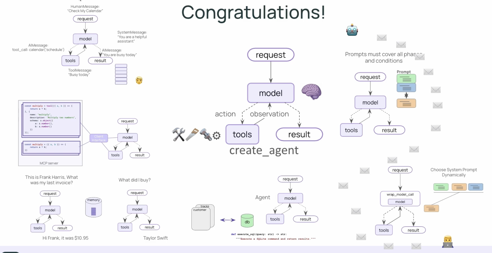

## LangChain parts:

- LangChain 
    - agents
        - create_agent
        - middleware
            - types (ModelRequest, dynamic_prompt)
            - HumanInTheLoopMiddleware

- LangChain Core
    - Messages (Human, AI, System, Tool)
    - Tools (@tool)
    
- LangChain Community
    - Utilities
        - SQLDatabase

- langchain_mcp_adapters
    - client (MultiServerMCPClient)

## LangGraph parts:

- LangGraph
    - runtime (get_runtime)
    - config
    - checkpoint
        - memory (InMemorySaver)
    - types (Command)

## LangChain Essentials course:

- Create Agent
- Models and Messages
- Streaming
- Tools
- Tools with MCP
- Memory
- Structured Output
- Dynamic Prompt
- Human in the loop

